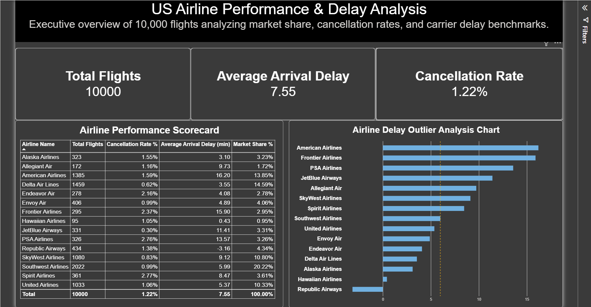

# ✈️ US Airline Performance & Delay Analysis

An executive Power BI dashboard analyzing 10,000 US flights to evaluate market share, cancellation rates, and carrier delay benchmarks.



---

## 📌 Business Overview

Flight delays and cancellations directly impact customer satisfaction and operational efficiency for airlines. This project provides an executive-level overview of US carrier performance, enabling stakeholders to:
- Identify industry market leaders and market share distribution.
- Monitor overall cancellation rates and average arrival delays across domestic routes.
- Benchmark individual carrier performance against industry delay averages.

---

## 📊 Key Findings & Insights

- **Market Leaders:** **Southwest Airlines** holds the largest market share at **20.22%** (2,022 flights), followed by **Delta Air Lines** at **14.59%** and **American Airlines** at **13.85%**.
- **Overall Operational Metrics:** Across the 10,000 flight sample, the average arrival delay stands at **7.55 minutes**, with a overall cancellation rate of **1.22%**.
- **Delay Outliers:** **American Airlines** (16.20 min) and **Frontier Airlines** (15.90 min) exhibit the highest average arrival delays, significantly exceeding the 7.55-minute benchmark.
- **Top Reliability Performers:** **Republic Airways** (-3.16 min) and **Hawaiian Airlines** (0.43 min) lead in on-time arrival performance.

---

## 🛠️ Tech Stack & Methods

- **Business Intelligence Tool:** Power BI Desktop
- **Data Modeling & DAX:** Measure creation for total flights, cancellation percentage, average arrival delays, and market share percentages.
- **Data Visualization:** Executive scorecard cards, tabular performance metrics, and horizontal bar charts for delay outlier comparison.

---

## 📁 Repository Structure

```text
us-airline-performance-analysis/
├── Airline_Delay_Analysis.pbix  # Interactive Power BI report file
├── dashboard_preview.png        # High-resolution visual preview
└── README.md                    # Project documentation
